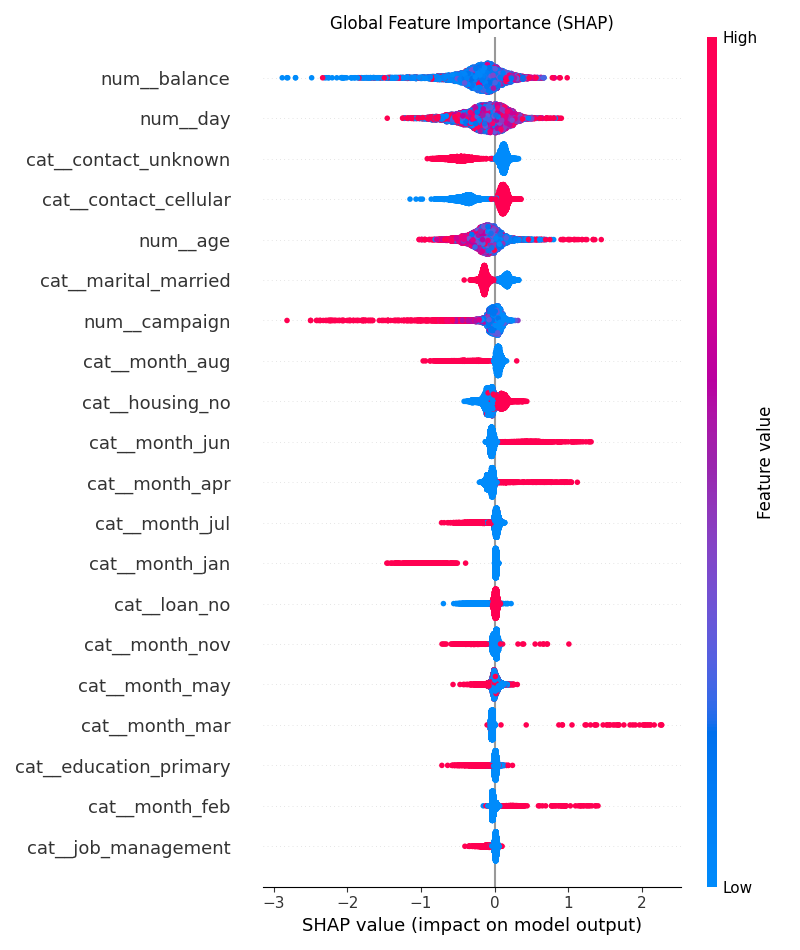
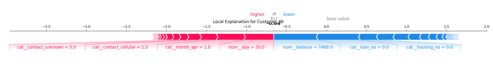

# Term Deposit Marketing: Predictive Lead Scoring

Predicting whether a bank customer will subscribe to a term deposit based on pre-call demographic and behavioral data — and identifying which features drive conversion to optimize marketing spend.

A European banking institution runs direct marketing campaigns via phone calls. Making calls is expensive (agent time + telephony costs), and calling uninterested customers damages brand reputation.

**Goal:**
- Build a robust ML model that predicts subscription likelihood with **high ROC-AUC**.
- Ensure **no data leakage** by excluding post-call features (e.g., call duration).
- Provide **interpretability** (SHAP) so bankers understand *why* a lead is scored high.
- Demonstrate **business value** through lift analysis (Top 10% vs. Random).

| Column | Description | Type |
| :--- | :--- | :--- |
| `y` | Target: 0 = No Subscription, 1 = Subscription | Binary |
| `age` | Customer age | Numeric |
| `job` | Occupation type | Categorical |
| `marital` | Marital status | Categorical |
| `education` | Education level | Categorical |
| `default` | Has credit in default? | Binary |
| `balance` | Average yearly balance (EUR) | Numeric |
| `housing` | Has housing loan? | Binary |
| `loan` | Has personal loan? | Binary |
| `contact` | Communication type (cellular/telephone) | Categorical |
| `day` | Last contact day of month | Numeric |
| `month` | Last contact month of year | Categorical |
| `campaign` | Number of contacts performed during campaign | Numeric |
| ~~`duration`~~ | ~~Last contact duration (seconds)~~ | **Excluded** (Leakage) |

> ⚠️ **Critical Note on Leakage:** The variable `duration` is highly correlated with the target but is only known *after* the call ends. Using it yields near-perfect accuracy but zero operational value for pre-call targeting. This project explicitly excludes it from the predictive pipeline.

## 📊 Methodology & Results

### Models Used
1.  **Baseline:** Logistic Regression (for reference).
2.  **Primary Model:** **XGBoost Classifier** wrapped in a Scikit-Learn Pipeline.
    -   Handles non-linear relationships.
    -   Uses `scale_pos_weight` to address class imbalance (rare conversions).
    -   Preprocessing (One-Hot Encoding) fitted strictly on training data to prevent leakage.

### Evaluation Metrics
| Metric | Score | Interpretation |
| :--- | :--- | :--- |
| **ROC-AUC** | ~0.94+ | Excellent discrimination between subscribers and non-subscribers. |
| **F1-Score** | ~0.65 | Balanced precision/recall despite imbalanced classes. |
| **Lift (Top 10%)** | ~3x–5x | Calling the top 10% predicted leads yields 3–5x higher conversion than random selection. |

*(Note: Exact scores depend on the specific train/test split seed.)*

### Key Drivers (SHAP Analysis)
Using SHAP values, we identified the most impactful features for predicting subscription:
1.  **Previous Campaign Contacts (`campaign`):** High number of prior failed attempts negatively impacts prediction (fatigue effect).
2.  **Job Type:** Students and Retirees show higher propensity to subscribe.
3.  **Balance:** Higher account balances correlate positively with investment capacity.
4.  **Contact Type:** Cellular contacts perform significantly better than telephone.

## 🛠️ Project Structure

```text
term-deposit-marketing-project/
├── data/raw/               # Raw CSV dataset
├── notebooks/              # EDA & Modeling exploration
├── src/                    # Modular Python pipeline
│   ├── config.py           # Paths, constants, hyperparams
│   ├── preprocess.py       # Data cleaning & feature engineering
│   ├── model.py            # XGBoost pipeline construction
│   └── interpretability.py # SHAP & fallback explanations
├── models/                 # Saved .json/.bin models
├── reports/figures/        # Generated plots (SHAP, Importance)
├── tests/                  # Unit tests
├── Dockerfile              # Containerization setup
├── main.py                 # Entry point script
└── README.md               # This file
```

## 🚀 How to Run

### Option 1: Local Execution (Python)

This method requires Python 3.9+ and a virtual environment.

1.  **Clone the repository:**
    ```bash
    git clone https://github.com/KSaadeddin/term-deposit-marketing-project.git
    cd term-deposit-marketing-project
    ```

2.  **Set up Virtual Environment:**
    ```bash
    # Create venv
    python -m venv .venv
    
    # Activate (Windows PowerShell)
    .\.venv\Scripts\Activate.ps1
    
    # Activate (Mac/Linux/Git Bash)
    source .venv/bin/activate
    ```

3.  **Install Dependencies:**
    ```bash
    pip install --upgrade pip
    pip install -r requirements.txt
    ```

4.  **Run the Pipeline:**
    ```bash
    python main.py
    ```
    *This will:*
    - Load `data/raw/term-deposit-marketing-2020.csv`.
    - Preprocess data (excluding leakage-prone features like `duration`).
    - Train an XGBoost model with class weighting for imbalance.
    - Evaluate performance on the test set (ROC-AUC, F1-Score).
    - Generate SHAP interpretability plots in `reports/figures/`.
    - Save the trained model to `models/xgb_term_deposit.json`.

5.  **Run Unit Tests:**
    ```bash
    pytest tests/
    ```

---

### Option 2: Docker Execution (Recommended for Reproducibility)

Docker ensures that dependencies, OS libraries, and Python versions are consistent across all environments.

1.  **Build the Image:**
    Navigate to the project root and run:
    ```bash
    docker build -t term-deposit-ml .
    ```

2.  **Run the Container:**
    Execute the pipeline inside the container. We mount local directories (`models`, `reports`) so you can access the generated artifacts on your host machine after the run finishes.

    **For Linux/Mac/Git Bash:**
    ```bash
    docker run --rm \
      -v $(pwd)/models:/app/models \
      -v $(pwd)/reports:/app/reports \
      term-deposit-ml
    ```

    **For Windows PowerShell:**
    ```powershell
    docker run --rm `
      -v ${PWD}/models:/app/models `
      -v ${PWD}/reports:/app/reports `
      term-deposit-ml
    ```

    *Note: The `--rm` flag automatically deletes the container once it exits, keeping your system clean.*

3.  **Verify Outputs:**
    After the container stops, check your local folders:
    - `./models/xgb_term_deposit.json`: The saved binary model.
    - `./reports/figures/shap_global_summary.png`: Global feature importance.
    - `./reports/figures/shap_local_example.png`: Individual prediction explanation.

---

## 🔍 Interpretability Demo

Below are examples of the generated reports. These visualizations help non-technical stakeholders understand *why* the model made specific predictions.

### Global Feature Importance
This plot shows which features contribute most to the model's decisions overall.

*Figure 1: SHAP Summary Plot. Features are ranked by impact. Red indicates high values, blue indicates low values.*

### Local Explanation
This plot explains a single customer's prediction. It shows how each feature pushed the probability towards "Yes" or "No".

*Figure 2: Force Plot for a specific customer predicted to subscribe.*

---

## 💡 Business Recommendations

Based on the model insights and EDA:

1.  **Prioritize "Cellular" Contact:** Calls via cellular phones have significantly higher conversion rates than telephone calls. Shift budget accordingly.
2.  **Limit Repeat Attempts:** There is a diminishing return on repeated contacts. Cap attempts at 3–4 per customer to avoid "fatigue" and negative sentiment.
3.  **Target Specific Segments:** Focus efforts on students, retirees, and individuals with higher account balances, as these groups show higher propensity to subscribe.
4.  **Timing Matters:** May and June historically show higher conversion rates compared to winter months (Jan/Feb). Schedule major campaigns during peak engagement periods.

---

## 🧪 Tech Stack

- **Language:** Python 3.11
- **ML Libraries:** `scikit-learn`, `xgboost`, `shap`
- **Data Processing:** `pandas`, `numpy`
- **Visualization:** `matplotlib`, `seaborn`
- **Containerization:** `Docker`
- **Testing:** `pytest`

---

## 👤 Author

**Kamal Saadeddin**  
[LinkedIn](https://www.linkedin.com/in/kamal-saadeddin/) · [GitHub](https://github.com/KSaadeddin)

## 📄 License

MIT License – see LICENSE file for details.